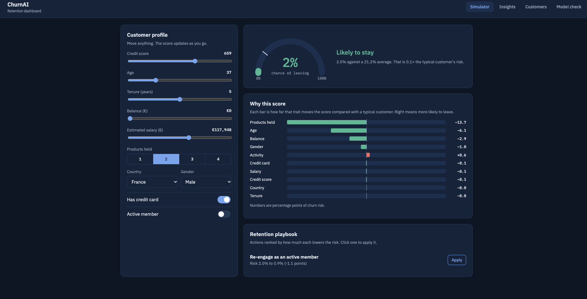
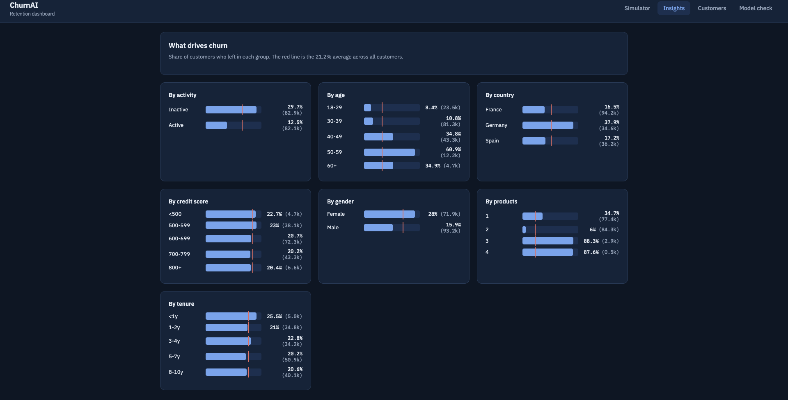
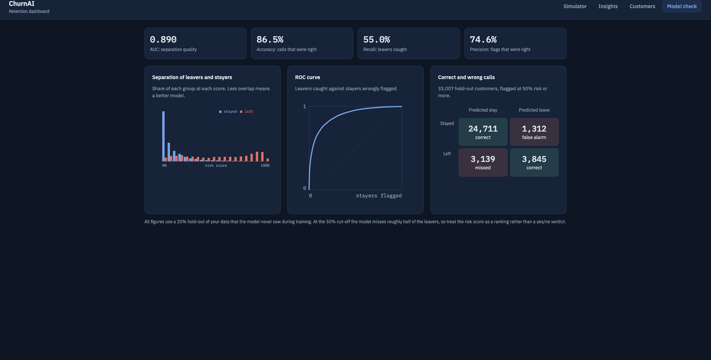
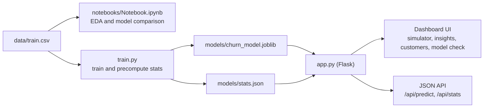

<div align="center">

# ChurnAI

### Bank customer churn: from model research to a live retention dashboard

Predict which customers are likely to leave, understand why, and see which actions lower the risk the most.


[Overview](#overview) · [Quick start](#quick-start) · [Research notebook](#part-1-research-notebook) · [Dashboard](#part-2-the-dashboard) · [API](#api-reference) · [Deployment](#deployment) · [Limitations](#limitations-and-responsible-use)

</div>






---

## Overview

ChurnAI is an end-to-end churn project with two connected parts.

| | Part 1: Research | Part 2: Product |
|---|---|---|
| **Where** | `notebooks/Notebook.ipynb` | `train.py`, `app.py`, `templates/index.html` |
| **Purpose** | Explore the data, engineer features, compare four gradient-boosting and forest models | Serve a trained model through an interactive dashboard and API |
| **Output** | Findings, model comparison, tuned candidates | Live risk score, explanations, retention actions, insights, model check |
| **Audience** | Data scientists | Retention and relationship managers |

### At a glance

| | |
|---|---|
| **Dataset** | 165,034 bank customers, 14 columns, no missing values or duplicates |
| **Target** | `Exited` (1 = customer left). Overall churn rate: **21.2%** |
| **Best research result** | Validation AUC about **0.897** (XGBoost, LightGBM and CatBoost are within 0.001 of each other) |
| **Dashboard model** | Gradient boosting, **0.890 AUC** and **86.6% accuracy** on a 33,007-customer hold-out |
| **Biggest churn drivers** | Number of products, age, country (Germany), inactivity |
| **Stack** | Python, pandas, scikit-learn, XGBoost, LightGBM, CatBoost, Flask, vanilla JavaScript |

### Architecture



> **Note on the two parts.** The notebook is the research record: it compares four model families on a shared preprocessing pipeline. The dashboard trains its own, simpler model in `train.py` so the app has no dependency on the notebook's pipeline. Their accuracy is comparable (see [How the two parts relate](#how-the-two-parts-relate)).

---

## Quick start

### Requirements

- Python 3.9 or newer
- About 300 MB of disk space for the dashboard dependencies (the notebook needs more)

### Run the dashboard

```bash
# 1. Clone
git clone https://github.com/<your-username>/<your-repo>.git
cd <your-repo>

# 2. Create a virtual environment (recommended)
python -m venv .venv
source .venv/bin/activate          # Windows: .venv\Scripts\activate

# 3. Install dependencies
pip install -r requirements.txt

# 4. Train the model (under a minute on a typical laptop)
python train.py

# 5. Start the app
python app.py
```

Open **http://localhost:5000**.

`train.py` prints the average churn rate, AUC, accuracy and recall when it finishes. Step 4 is optional if `models/churn_model.joblib` and `models/stats.json` already exist.

> **scikit-learn versions.** A saved `.joblib` file is only guaranteed to load with the scikit-learn version that created it. If you see a version warning or error, rerun `python train.py` in your own environment.

### Run the notebook

The notebook needs extra packages beyond the dashboard:

```bash
pip install jupyter numpy pandas matplotlib seaborn scikit-learn \
            xgboost lightgbm catboost category_encoders kagglehub
jupyter notebook notebooks/Notebook.ipynb
```

> The notebook reads `train.csv` from an absolute path on the author's machine. Before running it, change the `pd.read_csv(...)` line in the data-loading cell to `data/train.csv` (or `../data/train.csv`, depending on where you launch Jupyter).

---

## Project structure

```
.
├── app.py                    # Flask app: routes, validation, explanations, playbook
├── train.py                  # Dashboard model training and statistics
├── requirements.txt          # flask, pandas, scikit-learn, joblib
├── data/
│   └── train.csv             # 165,034 customers
├── models/
│   ├── churn_model.joblib    # Model, background sample, category lists
│   └── stats.json            # Insights, metrics, 400 scored customers, defaults
├── notebooks/
│   └── Notebook.ipynb        # EDA, feature engineering, model comparison
└── templates/
    └── index.html            # Entire front end (HTML, CSS, JavaScript)
```

---

## The dataset

`data/train.csv` has **165,034 customers** and **14 columns**. There are no missing values and no duplicate rows. It follows the layout of the Kaggle "Bank Customer Churn" playground data.

| Column | Type | Description |
|---|---|---|
| `id` | integer | Row identifier |
| `CustomerId` | integer | Customer identifier (141,813 repeated values, so not a unique key) |
| `Surname` | text | Customer surname (2,797 distinct values) |
| `CreditScore` | integer | Credit score (350 to 850) |
| `Geography` | category | France, Germany or Spain |
| `Gender` | category | Male or Female |
| `Age` | number | Age in years (18 and up) |
| `Tenure` | integer | Years as a customer (0 to 10) |
| `Balance` | number | Account balance in euros. About 89,648 customers (54%) have exactly zero |
| `NumOfProducts` | integer | Number of bank products held |
| `HasCrCard` | 0 / 1 | Has a credit card |
| `IsActiveMember` | 0 / 1 | Active member (82,149 active, 82,885 inactive) |
| `EstimatedSalary` | number | Estimated salary in euros |
| `Exited` | 0 / 1 | **Target:** 1 if the customer left |

The classes are imbalanced: **78.8% stayed and 21.2% left**. All splits in this project are stratified so each part keeps the same ratio.

---

## Part 1: Research notebook

`notebooks/Notebook.ipynb` documents the analysis and model comparison in six stages: problem statement, univariate analysis, bivariate analysis, feature engineering, preprocessing, and model training and evaluation.

### What the exploratory analysis found

| Finding | Evidence |
|---|---|
| **Germany has the highest churn** | Germany 37.9%, Spain 17.2%, France 16.5% |
| **Women churn more than men** | Female 28.0%, male 15.9% (full-dataset rates) |
| **Inactivity matters** | Inactive members churn at 29.7%, active members at 12.5% |
| **Credit card ownership adds little** | Among inactive members, churn is 29.3% with a card and 30.9% without. Among active members, 11.7% and 15.1% |
| **Tenure is a weak signal** | Churn by tenure year stays between about 19% and 25% |
| **Balance is lumpy** | More than half of customers hold a zero balance |
| **Linear correlations are weak** | Relationships with churn are mostly non-linear, which favours tree-based models |

### Feature engineering

| Step | Detail |
|---|---|
| **Dropped** | `CustomerId` (not a stable key) and `id` |
| **Target encoding** | `Surname`, `NumOfProducts`, `Gender`, `Geography` and `Tenure` encoded with scikit-learn's `TargetEncoder` (fit on the training split only inside the pipeline) |
| **One-hot encoding** | `Geography` and `Gender`, with the first level dropped |
| **Engineered: `ActiveCrCard`** | `HasCrCard + 4 * IsActiveMember`, so one number captures all four combinations of card and activity |
| **Engineered: `Tenure_to_Age_Ratio`** | `Tenure / Age`, a loyalty measure relative to life stage |
| **Scaling** | Median imputation and `StandardScaler` on numeric columns, then a final scaler over all columns |
| **Result** | **17 model-ready features** |

### Data splits

Stratified 80 / 10 / 10 split with `random_state=42`:

| Split | Rows |
|---|---:|
| Train | 132,027 |
| Validation | 16,503 |
| Test | 16,504 |

### Models compared

| Model | Key settings |
|---|---|
| Random Forest | 100 trees, `random_state=42`, otherwise defaults |
| XGBoost | 100 trees, depth 6, learning rate 0.1, subsample and column sample 0.8, early stopping on validation AUC (10 rounds) |
| LightGBM | 100 trees, learning rate 0.1, subsample and column sample 0.8 |
| LightGBM (tuned) | 5-fold grid search over 81 combinations (405 fits), scored on accuracy. Best: learning rate 0.1, depth 15, 200 trees, 20 leaves |
| CatBoost | 9,000 iterations at learning rate 0.0009, evaluated on validation AUC |

### Results

| Model | Validation accuracy | Test accuracy | Validation AUC | Test AUC |
|---|---:|---:|---:|---:|
| Random Forest | 86.6% | 85.9% | 0.888 | 0.881 |
| XGBoost | 87.0% | 86.5% | **0.897** | not reported |
| LightGBM | **87.1%** | 86.5% | 0.896 | not reported |
| LightGBM (tuned) | 87.0% | 86.4% | 0.897 | not reported |
| CatBoost | 87.0% | 86.4% | 0.896 | 0.890 |

What the comparison shows:

- **The boosting models are effectively tied.** Their validation AUCs sit within about 0.001 of each other, so choosing between them is a matter of speed and convenience, not accuracy.
- **Random Forest overfits.** Its training AUC is 1.000 against a validation AUC of 0.888, and it is the weakest of the five.
- **Tuning added almost nothing.** The grid search (optimised for accuracy) landed on the same performance as the default LightGBM, which suggests the data, not the hyperparameters, sets the ceiling.
- **Accuracy is not the whole story.** With 21% churners, a model can reach about 79% accuracy by predicting "stays" for everyone. AUC and recall are better guides for a retention use case.

### How the two parts relate

| | Notebook (best boosting models) | Dashboard model |
|---|---|---|
| Algorithm | XGBoost, LightGBM, CatBoost | scikit-learn `HistGradientBoostingClassifier` |
| Features | 17 engineered and encoded features, including target-encoded surname | 10 raw traits, no surname, no identifiers |
| Split | 80 / 10 / 10 | 80 / 20 |
| AUC | 0.896 to 0.897 (validation), 0.890 (CatBoost test) | 0.890 (20% hold-out) |
| Accuracy | 86.4% to 86.5% (test) | 86.6% (hold-out) |

The dashboard model gives up a little AUC in exchange for a much simpler deployment: it takes the ten fields a relationship manager actually knows, with no preprocessing pipeline to ship and no reliance on surname. If you want the notebook's best model in production, the preprocessing pipeline and chosen model would need to be saved and wired into `app.py`.

---

## Part 2: The dashboard

### Features

| Tab | What it does |
|---|---|
| **Simulator** | Sliders, switches and dropdowns for every trait. The risk dial updates live. There is no form to submit. |
| **Why this score** | Diverging bars show which traits push a customer toward leaving and which keep them, against a typical customer. |
| **Retention playbook** | Candidate actions ranked by how much each lowers predicted risk. One click applies an action to the simulator. |
| **Insights** | Churn rate by age, products, country, activity, credit score, tenure and gender, each compared with the 21.2% average. |
| **Customers** | 400 customers from a hold-out the model never trained on, scored and searchable. Click a row to load it into the simulator. |
| **Model check** | AUC, accuracy, precision and recall, a leaver and stayer separation chart, an ROC curve and a confusion matrix. |

Also included: light and dark themes that follow the operating system, a responsive layout for phones, server-side input validation, and a `/health` endpoint.

### The dashboard model

| Setting | Value |
|---|---|
| Algorithm | `HistGradientBoostingClassifier` |
| Iterations / learning rate / leaves | 300 / 0.08 / 31 |
| Categorical handling | Native for `Geography` and `Gender` |
| Input features | `CreditScore`, `Geography`, `Gender`, `Age`, `Tenure`, `Balance`, `NumOfProducts`, `HasCrCard`, `IsActiveMember`, `EstimatedSalary` |
| Excluded | `id`, `CustomerId`, `Surname` |
| Split | 80 / 20, stratified, `random_state=42` |

The 400 customers in the list come from the held-out 20%, so the scores shown for them are genuine out-of-sample predictions.

### Performance

Measured on **33,007 held-out customers** at a 50% decision threshold.

| Metric | Value | Meaning |
|---|---:|---|
| **AUC** | 0.890 | How well the model ranks leavers above stayers |
| **Accuracy** | 86.6% | Share of all calls that were right |
| **Precision** | 74.7% | When it flags a customer, how often it is right |
| **Recall** | 55.2% | Share of real leavers it catches |

|  | Predicted stay | Predicted leave |
|---|---:|---:|
| **Actually stayed** | 24,717 (correct) | 1,306 (false alarm) |
| **Actually left** | 3,128 (missed) | 3,856 (correct) |

The model ranks customers well but is conservative at 50%, so it misses about 45% of leavers. If missing a leaver costs more than contacting a stayer, work down the list from the highest risk score or use a lower threshold. A lower threshold raises recall and lowers precision.

### What the data says about churn

Churn rates from the full dataset (average 21.2%):

| Group | Churn rate | | Group | Churn rate |
|---|---:|---|---|---:|
| Age 18-29 | 8.4% | | France | 16.5% |
| Age 30-39 | 10.8% | | **Germany** | **37.9%** |
| Age 40-49 | 34.8% | | Spain | 17.2% |
| **Age 50-59** | **60.9%** | | Active member | 12.5% |
| Age 60+ | 34.9% | | Inactive member | 29.7% |
| 1 product | 34.7% | | Female | 28.0% |
| **2 products** | **6.0%** | | Male | 15.9% |
| 3 products | 88.3% | | | |
| 4 products | 87.6% | | | |

Two-product customers are by far the most loyal, while customers with three or four products almost all leave. Churn peaks in the fifties, German customers leave at more than twice the rate of French and Spanish ones, and inactive members churn at more than twice the rate of active ones. These are historical correlations. They describe who left, not why.

### How the explanation works

For each trait, the app swaps its value for values from a background sample of 300 real customers, scores every variant and averages the results. A trait's **effect** is the customer's actual score minus that average. A positive effect raises this customer's risk relative to a typical one, and a negative effect lowers it. Effects are in percentage points.

This is a simple, model-agnostic method. It is not SHAP, and effects will not sum exactly to the gap between the score and the average because the model contains interactions.

### How the playbook works

The app builds actions that apply to the customer's current profile, re-scores the customer with each change and keeps those that lower risk by more than 0.5 percentage points (up to four, best first).

| Candidate action | Change tested | Offered when |
|---|---|---|
| Re-engage as an active member | `IsActiveMember = 1` | Customer is inactive |
| Move to two products | `NumOfProducts = 2` | Product count is not 2 |
| Offer a credit card | `HasCrCard = 1` | Customer has no card |
| Add a third product | `NumOfProducts = 3` | Two products and active |
| Offer a balance-linked savings deal | `Balance` reduced by 25% | Balance is above zero |

> The playbook shows what the **model** predicts if a trait changed. It does not prove the real-world action would cause that change.

### Simulator reference

| Control | Range |
|---|---|
| Credit score | 300 to 850 |
| Age | 18 to 92 |
| Tenure | 0 to 10 years |
| Balance | €0 to €250,000 |
| Estimated salary | €0 to €200,000 |
| Products held | 1 to 4 |
| Country, gender | France, Germany, Spain / Female, Male |
| Credit card, active member | On or off |

| Predicted risk | Label |
|---|---|
| Under 20% | Likely to stay |
| 20% to 49% | Worth watching |
| 50% and above | Likely to leave |

A tick on the dial marks the 21.2% average so you can see at a glance whether a customer is above or below typical.

---

## API reference

<details>
<summary><strong>GET /api/stats</strong>: precomputed statistics for the charts and customer list</summary>

| Field | Description |
|---|---|
| `base_rate` | Overall churn rate, in percent |
| `n` | Number of training rows |
| `insights` | Churn rate and group size per breakdown |
| `customers` | The 400 scored sample customers |
| `model` | Metrics, ROC points, score histograms, confusion matrix counts |
| `defaults` | Starting profile for the simulator |
| `categories` | Allowed `Geography` and `Gender` values |

</details>

<details>
<summary><strong>POST /api/predict</strong>: score one customer</summary>

**Request**

```json
{
  "CreditScore": 650,
  "Age": 48,
  "Tenure": 3,
  "Balance": 120000,
  "EstimatedSalary": 90000,
  "NumOfProducts": 1,
  "HasCrCard": 1,
  "IsActiveMember": 0,
  "Geography": "Germany",
  "Gender": "Female"
}
```

**Example**

```bash
curl -X POST http://localhost:5000/api/predict \
  -H "Content-Type: application/json" \
  -d '{"CreditScore":650,"Age":48,"Tenure":3,"Balance":120000,"EstimatedSalary":90000,"NumOfProducts":1,"HasCrCard":1,"IsActiveMember":0,"Geography":"Germany","Gender":"Female"}'
```

**Response** (shortened)

```json
{
  "prob": 0.885,
  "explain": [
    {"feature": "Age", "label": "Age", "effect": 0.283},
    {"feature": "Geography", "label": "Country", "effect": 0.228}
  ],
  "playbook": [
    {"title": "Move to two products", "change": {"NumOfProducts": 2}, "new_prob": 0.65, "delta": -0.234}
  ]
}
```

The full response lists all ten traits in `explain` and up to four actions in `playbook`.

**Errors.** A missing field, non-numeric value, or unknown `Geography` or `Gender` returns HTTP `400` with `{"error": "..."}`.

</details>

<details>
<summary><strong>GET /health</strong> and <strong>GET /</strong></summary>

`/health` returns `{"status": "healthy", "model_loaded": true, "rows_trained": 165034}`. `/` returns the dashboard page.

</details>

---

## Configuration and customisation

| I want to... | Do this |
|---|---|
| **Use my own data** | Replace `data/train.csv` with a file using the same columns, run `python train.py`, restart the app. If column names differ, update `FEATURES` and `CAT` in `train.py`, `clean()` and `LABELS` in `app.py`, and the controls in `templates/index.html`. |
| **Tune the model** | Edit the `HistGradientBoostingClassifier(...)` call in `train.py` (`max_iter`, `learning_rate`, `max_leaf_nodes`, `l2_regularization`) and compare the printed AUC and recall. |
| **Change the 50% cut-off** | Change `p >= 0.5` in `train.py` for the confusion matrix, precision and recall. |
| **Change the risk bands** | Edit the verdict thresholds in `render()` in `templates/index.html`. |
| **Add a playbook action** | Add a title and field changes to the `playbook()` function in `app.py`. It is scored and ranked automatically. |
| **Change host or port** | Edit `app.run(host="0.0.0.0", port=5000, debug=False)` at the bottom of `app.py`. |

---

## Deployment

`app.run` is Flask's development server. For production use a WSGI server.

**Gunicorn**

```bash
pip install gunicorn
gunicorn -w 2 -b 0.0.0.0:8000 app:app
```

The model loads once per worker, so memory grows with the worker count.

**Docker**

```dockerfile
FROM python:3.11-slim
WORKDIR /app
COPY requirements.txt .
RUN pip install --no-cache-dir -r requirements.txt gunicorn
COPY . .
RUN python train.py
EXPOSE 8000
CMD ["gunicorn", "-w", "2", "-b", "0.0.0.0:8000", "app:app"]
```

```bash
docker build -t churnai .
docker run -p 8000:8000 churnai
```

Training during the image build keeps the model and the scikit-learn version in sync.

**Production notes**

- Serve over HTTPS and add authentication. The app handles customer data.
- The page loads IBM Plex fonts from Google Fonts. Remove the font `<link>` tags in `templates/index.html` for offline or privacy-restricted setups. System fonts are used instead.

---

## Limitations and responsible use

- **Correlation, not causation.** The playbook shows how the model's prediction changes, not how a real customer would respond. Pilot retention actions with a controlled test before scaling them.
- **Unusual patterns in the data.** Customers with three or four products almost all churn. This may reflect how the data was generated or how products were sold, so check it against business knowledge.
- **Moderate recall.** At a 50% threshold the dashboard model misses about 45% of leavers. "Likely to stay" is not a guarantee.
- **Fairness.** Gender and country are model inputs and the data shows large churn gaps across them. Before using scores in decisions that affect customers, confirm that using these traits is appropriate and lawful where you operate, and consider removing them.
- **Surname in the notebook.** The notebook target-encodes surname, which can act as a proxy for ethnicity or family. The dashboard model does not use it. Review this before adopting surname-based features.
- **Metrics and thresholds.** Notebook tuning optimised accuracy, which is weak on imbalanced data. Choose a metric and threshold that reflect the real cost of missing a leaver.
- **Data drift.** Customer behaviour changes. Retrain regularly and monitor performance on recent data.
- **Approximate explanations.** The "Why this score" bars use a swap-and-compare method, not exact attribution.
- **Privacy.** Do not commit real customer data to a public repository. If `data/train.csv` is real, add it to `.gitignore`.

---

## Troubleshooting

<details>
<summary>Common problems and fixes</summary>

| Problem | Fix |
|---|---|
| `FileNotFoundError` for `churn_model.joblib` on startup | Run `python train.py` first. |
| Version warning or error when loading the model | Retrain with `python train.py` in your current environment. |
| `ModuleNotFoundError` | Activate your virtual environment and run `pip install -r requirements.txt` (or the notebook install command). |
| Notebook fails on `read_csv` | The path in the notebook is absolute to the author's machine. Point it at `data/train.csv`. |
| Dial shows "Could not score" | Check the terminal for a Flask error and test `/api/predict` with `curl`. |
| Port 5000 already in use | Change `port=5000` in `app.py`. On macOS, AirPlay Receiver often uses port 5000. |
| Fonts look different from screenshots | The Google Fonts request is blocked and system fonts are used. This is harmless. |

</details>

---

## Roadmap

- [ ] Ship the notebook's best pipeline and model as an alternative backend
- [ ] Calibrated probabilities and a threshold picker based on retention cost
- [ ] SHAP-based explanations
- [ ] Batch scoring: upload a CSV, download scored results
- [ ] Imbalance handling experiments (class weights, SMOTE) with recall as the target metric
- [ ] Unit tests for the API and playbook logic
- [ ] Authentication and role-based access

## Contributing

1. Fork the repository and create a branch: `git checkout -b feature/my-change`
2. Make your change and confirm `python train.py` and `python app.py` still run cleanly.
3. Open a pull request describing what changed and why.

Please open an issue first for large changes.

## License

No license has been chosen yet. Add a `LICENSE` file (for example MIT) before publishing so others know how they may use the code, then replace this section with the license name.

## Acknowledgements

- Dataset layout follows the Kaggle Playground "Bank Customer Churn" competition.
- Built with [scikit-learn](https://scikit-learn.org), [XGBoost](https://xgboost.ai), [LightGBM](https://lightgbm.readthedocs.io), [CatBoost](https://catboost.ai) and [Flask](https://flask.palletsprojects.com).